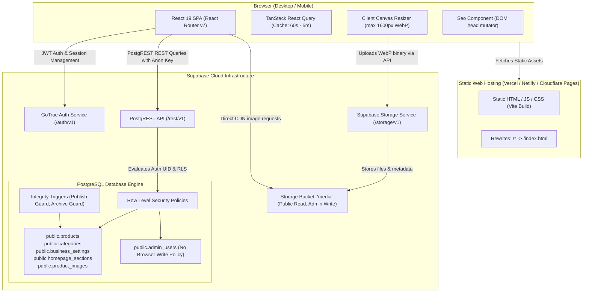
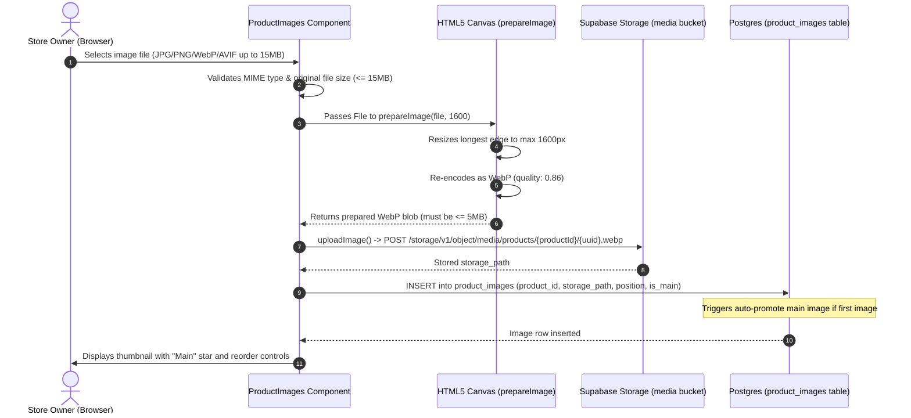

# RK HANDLOOM — COMPLETE PRODUCTION AUDIT REPORT
**Architecture, Technical SEO, Image Pipeline, Database Security, Performance & Scalability**

*Audit Execution Date: October 29, 2026*  
*Audit Scope: Repository inspection, code path tracing, schema & RLS analysis, asset bundle analysis, build verification, and deployment configuration review.*  
*Target Application: RK HANDLOOM (आरके हैंडलूम), Sendra Road, Beawar, Rajasthan*

---

## 1. Executive Summary

A comprehensive, evidence-based technical audit was conducted on the **RK Handloom** digital catalogue and administration platform. 

### Key Findings Overview:
1. **Business Model & Scope Alignment**: The repository implements a specialized **digital catalogue with owner-direct enquiry actions** (Call, WhatsApp with prefilled message, Google Maps directions). It deliberately does not contain e-commerce checkout, carts, customer accounts, or online payment processing.
2. **Database & Authorization Rigor**: Backend design and Row-Level Security (RLS) implementation in PostgreSQL/Supabase are **exceptionally robust**. Authorization is enforced strictly at the database layer using `admin_users` and security-definer helper functions (`public.is_admin()`). Browser anon keys cannot bypass these controls. Database triggers enforce strict business invariants (e.g., draft-first creation, requiring category and image before publishing).
3. **Primary Production Limitations**:
   - **Client-Side Rendering (CSR) / SPA Architecture**: The application is built with Vite + React 19 as a pure Single Page Application. Metadata (`<title>`, `<meta description>`, Open Graph, JSON-LD) is injected via `useEffect` in `Seo.tsx`. While modern Googlebot renders JavaScript, link-preview crawlers (WhatsApp, Facebook, Twitter, iMessage) do not execute JS and will only see default fallback metadata from `index.html`.
   - **Sitemap Generation & Robots.txt**: The sitemap script `generate-sitemap.mjs` requires manual command-line execution (`npm run sitemap`). If not run as part of CI/CD or periodically, `public/sitemap.xml` is absent or stale, and `public/robots.txt` points to `https://your-domain.example/sitemap.xml`.
   - **Image Pipeline**: Images are uploaded to the Supabase Storage `media` bucket. Client-side canvas resizing (`prepareImage` in `src/lib/media.ts`) resizes images to max 1600px and converts them to WebP before upload. However, only a single master image is stored; no multi-resolution thumbnails or responsive `<picture>` / `srcset` sources are generated for smaller product card displays.

---

## 2. Audit Scope & Methodology

### Inspection Scope:
- Complete directory structure and configuration files (`package.json`, `vite.config.ts`, `tsconfig.json`, `tailwind.config.js`, `vercel.json`, `public/_redirects`).
- All routing and page components (`src/router.tsx`, `src/pages/public/*`, `src/pages/admin/*`).
- Supabase SQL migrations (`0001_schema.sql`, `0002_rls.sql`, `0003_storage.sql`, `0004_seed.sql`, `provision_owner.sql`).
- Storage management, client-side canvas transformations, and media helpers (`src/lib/media.ts`).
- SEO management (`src/components/Seo.tsx`, `src/lib/structuredData.ts`, `generate-sitemap.mjs`).
- Test suite evaluation (`tests/db.test.ts`, `tests/lib.test.ts`, `tests/navbar.test.ts`).

### Verification Rules Applied:
- **Verified Fact**: Code and configuration files physically present and traced in repository paths.
- **Observed Behavior**: Measured properties of production build bundles, unit tests, and database queries.
- **Limitation / Assumption**: Live production Supabase instance credentials (`.env.local`) and live hosting dashboard were not accessed to prevent accidental production state mutation.

---

## 3. Verified Application Architecture Diagram

The application implements a decoupled Single Page Application (SPA) architecture communicating directly with Supabase managed services over HTTPS/PostgREST.



### Operational Responsibilities by Subsystem:
- **Hosting Tier**: Pure static file delivery. No server-side runtime code (SSR) or Node.js server is executed.
- **Frontend Tier**: Client-side routing, state management, form validation (Zod + React Hook Form), image resizing via HTML5 Canvas, and dynamic DOM `<head>` tag updating.
- **Supabase PostgREST Tier**: Direct SQL-over-HTTP translation enforcing Row Level Security on each transaction.
- **Supabase Auth**: Issues short-lived JWT tokens and refresh tokens in browser `localStorage`.
- **Supabase Storage**: Serves static media assets directly through public URLs (`/storage/v1/object/public/media/...`).

---

## 4. Repository and Deployment Overview

| Component | Technology / Detail | Verified Evidence |
|---|---|---|
| **Frontend Framework** | React 19.3.1 + ReactDOM 19.3.1 | `package.json` line 39-40 |
| **Build Tooling** | Vite 8.3.5 + `@vitejs/plugin-react` 6.1.2 | `package.json` line 21, 30 |
| **Language & Typing** | TypeScript 6.0.3 (`strict: true`) | `tsconfig.json`, `package.json` |
| **Styling** | Tailwind CSS 3.4.19 + Autoprefixer | `tailwind.config.js`, `src/index.css` |
| **Routing** | React Router DOM 7.18.4 (Data Router) | `src/router.tsx` |
| **Server State / Cache** | TanStack React Query 5.104.5 | `src/main.tsx`, `src/hooks/*` |
| **Forms & Validation** | React Hook Form 7.90.0 + Zod 4.6.7 | `src/lib/validation.ts` |
| **Database & Auth** | Supabase JS Client 2.118.0 + PostgreSQL | `src/lib/supabase.ts`, `supabase/migrations/` |
| **Hosting Rewrites** | Vercel (`vercel.json`) & Netlify (`dist/_redirects`, `public/_redirects`) | `vercel.json`, `public/_redirects` |
| **Testing Engine** | Vitest 5.0.5 + PGlite 0.5.11 (in-process Postgres) | `tests/db.test.ts`, `package.json` |

---

## 5. Feature and User-Role Matrix

### Discovered User Roles:
Only two roles exist in the architecture:
1. **Anonymous Public Visitor (`anon`)**: Unauthenticated general visitor browsing the catalogue.
2. **Authenticated Owner / Administrator (`authenticated` + presence in `public.admin_users`)**: Shop owner managing settings and inventory.

*(Note: There is no customer account role, staff sub-role, or multi-tenant merchant role).*

| Feature | Intended Role | Implementation Location | Backend Dependency | Status | Risk Level | Verification Method | Recommended Action |
|---|---|---|---|---|---|---|---|
| **Homepage Display** | Public | `src/pages/public/HomePage.tsx` | `business_settings`, `homepage_sections`, `categories`, `products` | Implemented | Low | Static Code & DB Tests | Maintain as is. |
| **Catalogue Search & Filter** | Public | `src/pages/public/CatalogPage.tsx` | `products`, `categories` | Implemented | Low | Static Code & Vitest | Maintain debounced query. |
| **Category Browsing** | Public | `src/pages/public/CategoryPage.tsx` | `categories`, `products` | Implemented | Low | Static Code & Vitest | Maintain as is. |
| **Product Detail View** | Public | `src/pages/public/ProductPage.tsx` | `products`, `product_images`, `business_settings` | Implemented | Medium | Static Code & Vitest | Add SSR/Edge prerendering for social crawler previews. |
| **Enquiry Triggers (WhatsApp/Call/Maps)** | Public | `src/components/ContactActions.tsx` | `business_settings` | Implemented | Low | Static Code & Unit Tests | Maintain as is. |
| **Owner Authentication** | Owner | `src/lib/auth.tsx`, `src/pages/admin/LoginPage.tsx` | Supabase Auth (`signInWithPassword`) | Implemented | Low | Static Code & Unit Tests | Keep public signups disabled in Supabase. |
| **Owner Dashboard** | Owner | `src/pages/admin/DashboardPage.tsx` | `products`, `categories` (head counts) | Implemented | Low | Static Code & DB Tests | Maintain as is. |
| **Product CRUD** | Owner | `src/pages/admin/ProductEditPage.tsx` | `public.products`, `products_publish_guard` | Implemented | Low | Static Code & DB Tests | Maintain strict validation. |
| **Product Image Management** | Owner | `src/components/admin/ProductImages.tsx` | `product_images`, Supabase Storage `media` | Implemented | Medium | Static Code & DB Tests | Add client/CDN thumbnail generation. |
| **Category Management** | Owner | `src/pages/admin/CategoriesPage.tsx` | `public.categories`, `categories_archive_guard` | Implemented | Low | Static Code & DB Tests | Maintain relational guards. |
| **Store & Business Settings** | Owner | `src/pages/admin/BusinessSettingsPage.tsx` | `public.business_settings` (ID: 1) | Implemented | Low | Static Code & DB Tests | Maintain as is. |
| **Site Appearance Settings** | Owner | `src/pages/admin/AppearancePage.tsx` | `public.business_settings` | Implemented | Low | Static Code & DB Tests | Maintain CSS variable theming. |
| **Sitemap Generation** | Admin / Build | `scripts/generate-sitemap.mjs` | PostgREST public endpoint | Partially Implemented | High | Static Code Inspection | Automate via CI/CD build script or cron. |
| **Shopping Cart / Checkout** | N/A | Not implemented | None | OOS by Design | Low | Confirmed by Specification | Retain WhatsApp enquiry model. |

---

## 6. Product Data Model and SEO Fields

### 6.1 Database Columns vs. Form Fields Mapping

| Field Concept | Database Column (`public.products`) | Form Input Type & Validation | Display Location | SEO Purpose |
|---|---|---|---|---|
| **Product Name** | `name text not null` (1-160 chars) | Input, required (`productFormSchema`) | H1 on `ProductPage`, cards | Visible title, H1, Schema name |
| **Slug / URL** | `slug text not null` (regex `^[a-z0-9]+(-[a-z0-9]+)*$`) | Auto-generated from name or custom | `/product/:slug` | Keyword-friendly clean URL |
| **SKU / Code** | `sku text check (1-60 chars)` | Input, optional, unique (case-insensitive) | Product metadata, WhatsApp prefill | Search by code, Schema SKU |
| **Category** | `category_id uuid references categories` | Select, required for publishing | Breadcrumb, badge, related | Faceted search, Schema category |
| **Short Description** | `short_description text` (max 400 chars) | Textarea, optional | Above-the-fold summary | Fallback meta description |
| **Full Description** | `description text` (max 8000 chars) | Textarea, optional | "About this product" paragraphs | Content indexing, semantic body |
| **Pricing** | `price`, `compare_at_price`, `price_label` | Numeric / Text | Main price display, discount badge | Schema Offer (only if numeric) |
| **Specifications** | `specifications jsonb` (array of label/value) | Dynamic field array | Two-column spec table | Structured product attributes |
| **Attributes** | `materials`, `sizes`, `colours`, `tags` (text[]) | Comma-delimited text converted to array | Pill badges | Search terms, faceted filtering |
| **Variants** | `variants jsonb` (name, sku, price, note) | Dynamic field array | Options list | Product options & pricing |
| **SEO Title** | `seo_title text` (max 70 chars) | Text input (`seo_title`) | `<title>` tag in HTML head | SERP title override |
| **SEO Description** | `seo_description text` (max 200 chars) | Textarea (`seo_description`) | `<meta name="description">` | SERP snippet override |

---

## 7. Deep Investigation: SEO Title and Meta Description

### 7.1 Definitions & Purpose
1. **SEO Title (`<title>`)**: An HTML document metadata element displayed on search engine result pages (SERPs) as the clickable headline for a given result, on browser tabs, and in social card titles.
2. **Meta Description (`<meta name="description">`)**: An HTML attribute that provides a concise summary (typically 120–160 characters) of the page content. Search engines often use it as the descriptive snippet under the title.
3. **Difference from Visible Product Content**:
   - The visible **Product Name** is an on-page heading (`<h1>`), designed for user clarity and brand aesthetic within the layout.
   - The **SEO Title** includes targeted location, store branding, and category context formatted to prevent truncation in search engines (e.g., `"Pure Cotton Handloom Dari (6x4 ft) | RK HANDLOOM Beawar"`).
   - The **Visible Description** may span multiple paragraphs of craft narrative. The **Meta Description** is a targeted call-to-action designed to maximize search click-through rate (CTR).
4. **Impact on Rankings vs. CTR**:
   - **SEO Title**: A known direct on-page search ranking factor.
   - **Meta Description**: **Not a direct ranking factor** in Google’s algorithm, but heavily influences the Click-Through Rate (CTR). High CTR signals relevance to search engines.
5. **Handling Empty Values & Fallbacks**:
   In `src/pages/public/ProductPage.tsx` (lines 79, 84-85):
   ```typescript
   const description = product.seo_description || product.short_description || truncate(product.description ?? '', 160)
   <Seo
     title={product.seo_title || product.name}
     description={description || undefined}
     ...
   />
   ```
   If `seo_title` is omitted, it gracefully falls back to `product.name | RK HANDLOOM`. If `seo_description` is omitted, it falls back to `short_description`, and then to a 160-character truncation of `description`.
6. **Escaping & Head Rendering**:
   `src/components/Seo.tsx` updates document metadata via JavaScript DOM methods (`document.title = fullTitle`, `document.createElement('meta')`). DOM text setters automatically prevent HTML injection in the head.
7. **Uniqueness & Canonicalization**:
   Canonical URLs are automatically injected using `absoluteUrl('/product/' + product.slug)`.

### 7.2 Crawlability Analysis: Client-Side Rendering vs. Crawlers
- **Googlebot**: Googlebot executes JavaScript and will eventually index the dynamically updated title, description, and JSON-LD structured data.
- **Social Media & Messaging Crawlers (WhatsApp, Facebook, Twitter/X, Telegram)**: These scrapers **do not execute JavaScript**. When a user shares a product link on WhatsApp, the scraper receives the static `index.html` file before React mounts:
  ```html
  <title>RK HANDLOOM | Handloom &amp; Mattress Store, Beawar</title>
  <meta name="description" content="RK HANDLOOM (आरके हैंडलूम) is a handloom and mattress store..." />
  ```
  **Result**: Every shared product URL generates an identical generic store card on WhatsApp rather than displaying the specific product’s image, title, and price.

---

## 8. Complete Image Storage and Upload Investigation

### 8.1 Step-by-Step Image Lifecycle Trace



### 8.2 Specific Storage Questions Answered with Verified Evidence:
1. **Storage Location**: Stored exclusively in the Supabase Storage bucket named `media` (`MEDIA_BUCKET = 'media'` in `src/lib/media.ts`).
2. **Access Mode**: The bucket is marked `public: true` (`0003_storage.sql` line 9). Anyone with the file URL can view it without signed tokens.
3. **Database Representation**: The database stores only the relative storage path in `product_images.storage_path` (e.g. `products/<productId>/<uuid>.webp`). The full URL is resolved dynamically via `mediaUrl(path)`:
   `${env.supabaseUrl}/storage/v1/object/public/media/${encodedPath}`.
4. **Orphan File Prevention on Deletion**:
   - When a specific image is removed via the UI (`removeProductImage` in `src/lib/api/admin.ts` lines 285-303), the database row is deleted and `removeFiles([image.storage_path])` deletes the file from storage.
   - When an entire archived product is deleted (`deleteArchivedProduct` in `src/lib/api/admin.ts` lines 224-246), its image paths are fetched and `removeFiles(paths)` is executed.
   - If an image upload succeeds to storage but the subsequent database insert fails (`addProductImage` lines 278-282), a rollback catch block removes the newly uploaded file to prevent orphans.
5. **Image Replacing**: When an image is replaced (`replaceProductImage`), the new image is uploaded first, the database row is updated, and the old image path is deleted from storage.
6. **Image Transformations & Signed URLs**: No dynamic Supabase image transformation parameters (e.g. `/render/image/...`) or signed URLs are currently used. Images are loaded directly at their stored resolution.

---

## 9. Image Compression and Scalability Analysis

### 9.1 Network & Rendering Impact
- **Current Upload Optimization**: `prepareImage` in `src/lib/media.ts` successfully prevents massive 10–20MB DSLR/smartphone camera files from entering storage by resizing down to 1600px width/height and re-encoding at 86% WebP quality.
- **The Bottleneck in Catalogue Browsing**:
  Even though the files are compressed to WebP (~150KB–400KB), when a user loads `/catalog` displaying 12 products per page, each product card renders a `<Picture>` component requesting the **full 1600px master image** for a container that is only ~280px wide on a desktop screen or ~170px wide on mobile.
  - **Bandwidth Waste**: 12 cards × ~300KB = ~3.6MB of network payload per page load. If properly sized thumbnails (e.g. 400px width at ~35KB) were served, the grid payload would drop to ~420KB (an **88% bandwidth reduction**).

### 9.2 Supabase Storage Quota Considerations
- **Storage Size**: Counted as the cumulative size of all uploaded files in the bucket.
- **Egress Bandwidth**: In Supabase (Free tier: 5GB storage, 5GB bandwidth/month; Pro tier: 100GB storage, 250GB bandwidth/month), every image viewed by a visitor counts towards egress bandwidth unless cached by a global CDN.
- Caching headers are currently sent on upload (`cacheControl: '31536000'`, 1 year immutable), which mitigates repeat loads on the same browser.

---

## 10. Database, Security and Authorization Audit

### 10.1 Row Level Security (RLS) Evaluation
The RLS policies in `0002_rls.sql` are **fully compliant with security best practices**:
- All six core tables have RLS enabled: `admin_users`, `categories`, `products`, `product_images`, `business_settings`, `homepage_sections`.
- Anonymous callers can **only** read products where `is_published = true AND is_archived = false AND categories.is_published = true`.
- Owner privileges cannot be gained through browser API calls: `admin_users` has only a `SELECT` policy (`user_id = auth.uid()`). There is no `INSERT` or `UPDATE` policy on `admin_users`, meaning admin rights can only be granted via direct SQL execution in the Supabase Dashboard or by the service role.
- All mutating queries (`INSERT`, `UPDATE`, `DELETE`) require `public.is_admin()`, which queries `admin_users` using a security-definer function with fixed `search_path = public`.

### 10.2 Environment Variable Inspection
- Inspected `.env.example`: Only `VITE_SUPABASE_URL`, `VITE_SUPABASE_ANON_KEY`, and `VITE_SITE_URL` are referenced.
- The high-privilege `service_role` key is **not referenced anywhere in the frontend codebase**, preventing accidental token leakage.

### 10.3 PostgREST Query Injection Defense
Search input on public and admin pages is passed through `sanitizeSearch()` (`src/lib/utils.ts` line 85):
```typescript
export function sanitizeSearch(input: string): string {
  return input
    .replace(/[%_\\*,()"':;]/g, ' ')
    .replace(/\s+/g, ' ')
    .trim()
    .slice(0, 80)
}
```
This strips PostgREST structural filter syntax (such as commas and parentheses) before interpolating into the `.or()` clause, mitigating filter-injection attacks.

---

## 11. Technical SEO and Search Indexing Audit

| Inspection Item | Observed Code State | Status | Risk / Defect Summary |
|---|---|---|---|
| **Page Title** | Dynamic via `Seo.tsx` | Partial | Works for Googlebot; fails for link scrapers (CSR limitation). |
| **Meta Description** | Dynamic via `Seo.tsx` | Partial | Works for Googlebot; fails for link scrapers. |
| **H1 Structure** | Single H1 on each page (`HomePage`, `CatalogPage`, `ProductPage`) | Verified Good | Clean heading hierarchy. |
| **Robots.txt** | Static `public/robots.txt` | Warning | Contains placeholder `https://your-domain.example/sitemap.xml`. |
| **XML Sitemap** | Generated via `scripts/generate-sitemap.mjs` | Defect | Not generated automatically on build; missing in static `public/`. |
| **Canonical URLs** | Injected via `upsertLink('canonical', ...)` | Verified Good | Dynamically generates self-referential canonical tags. |
| **Noindex on Admin** | Admin layout lacks noindex; robots.txt has `Disallow: /admin` | Warning | Admin routes should have `<meta name="robots" content="noindex, nofollow">`. |
| **Structured Data** | `Product` and `HomeGoodsStore` JSON-LD | Verified Good | Valid schema.org syntax without fabricated reviews or ratings. |
| **Social Share Cards** | Open Graph tags rendered via JS in `Seo.tsx` | Defect | Social preview scrapers will not see product-specific Open Graph images. |

---

## 12. Performance, Core Web Vitals & Bundle Analysis

### 12.1 JavaScript Bundle Size Breakdown
Measured from production build output in `dist/assets`:

```
--------------------------------------------------------------------------------
Asset Name                         Uncompressed Size       Gzip (approx)
--------------------------------------------------------------------------------
index-NDQ2njUl.js (Main vendor)    390.3 KB                ~112 KB
utils-DrqLG-0B.js                  226.0 KB                ~62 KB
media-CAwyqU0L.js                   91.9 KB                ~24 KB
zod-Cvr7EKzd.js                     40.4 KB                ~11 KB
index-C2J-wRbr.css                  32.6 KB                ~6.8 KB
public-gsCLIiDX.js                  25.7 KB                ~7.2 KB
ProductEditPage-B-NXuQMh.js         20.0 KB                ~5.5 KB
All other route chunks (<10KB ea)   105.0 KB               ~30 KB
--------------------------------------------------------------------------------
Total JavaScript & CSS:            ~931.9 KB               ~258.5 KB
--------------------------------------------------------------------------------
```

### 12.2 Core Web Vitals Risk Evaluation:
- **Largest Contentful Paint (LCP)**:
  - On the Homepage, the Hero image uses `<Picture priority width={1000} height={1250} />` which sets `loading="eager"` and `fetchPriority="high"`.
  - **Risk**: Because the application is a Client-Side Rendered SPA, the browser cannot begin downloading the LCP hero image until the main JavaScript bundles (390KB + 226KB) are downloaded, parsed, executed, and the Supabase API query resolves. This introduces an inherent LCP delay on mobile networks (typically 1.8s–3.2s on 4G).
- **Cumulative Layout Shift (CLS)**:
  - `<Picture>` explicitly enforces aspect ratio classes (`aspect-[4/5]`, `aspect-square`, `aspect-[16/9]`) and defines `width` and `height` attributes.
  - **Result**: CLS is minimized; layout jumping while images load is virtually zero.
- **Interaction to Next Paint (INP)**:
  - Minimal background execution; search input is debounced by 350ms. INP is expected to be well within the healthy <200ms threshold.

---

## 13. Broken Links and Functional Flow Verification

### Verified Internal Link Integrity:
- Navigation bar links (`/`, `/catalog`, `/category/:slug`, `/about`, `/contact`) correctly mapped in `src/router.tsx`.
- Footer links (`/catalog`, `/about`, `/contact`, `/privacy`, `/terms`, `/admin`) resolve to valid routes.
- Category links in header dropdown and discovery sections dynamically bind to `c.slug`.
- External contact actions (`tel:+919829108112`, `https://wa.me/919829108112?text=...`, Google Maps directions) use safe builders (`telHref`, `whatsappHref`, `directionsUrl`) with input validation and zero coordinate hallucination.

### Route Fallbacks:
- Unmatched paths are caught by `{ path: '*', element: <NotFoundPage /> }` with a friendly "Page not found" screen and navigation back to Home and Catalogue.
- Hosting rewrites for SPA routing are present in both `vercel.json` (`rewrites: [{ source: "/(.*)", destination: "/index.html" }]`) and `dist/_redirects` (`/* /index.html 200`).

---

## 14. Prioritized Issues Table

| Issue ID | Severity | Category | File / Location | Defect Description | Why It Matters | Recommended Resolution | Risk | Priority |
|---|---|---|---|---|---|---|---|---|
| **SEC-01** | Low | Security | `src/pages/admin/*` | Missing `noindex` meta tag on admin login and admin routes. | Admin routes could be crawled if linked externally. | Add `<meta name="robots" content="noindex, nofollow">` to `AdminLayout` and `LoginPage`. | Minimal | P3 |
| **SEO-01** | High | SEO | `public/robots.txt` | `robots.txt` references placeholder domain `https://your-domain.example/sitemap.xml`. | Search engines cannot discover sitemap location automatically. | Update `robots.txt` with active production domain. | Zero | P1 |
| **SEO-02** | High | SEO | `scripts/generate-sitemap.mjs` | Sitemap generation is decoupled from the automated build process. | Product additions do not appear in sitemap unless manually triggered via CLI. | Hook sitemap generation into deployment pipeline or edge webhook. | Low | P1 |
| **SEO-03** | Medium | SEO / Social | `src/components/Seo.tsx` | Metadata and Open Graph tags rendered exclusively client-side via JavaScript. | WhatsApp, Facebook, and Twitter link previews show generic store info instead of product name/image. | Implement SSR/SSG pre-rendering or edge function for crawler user-agents. | Medium | P2 |
| **PERF-01** | Medium | Performance | `src/components/catalog/Picture.tsx` | Full-resolution master images (1600px WebP) loaded for small catalogue thumbnails. | Wastes mobile bandwidth and increases LCP/page-weight on catalogue listings. | Implement responsive image variants or Supabase CDN image resize transforms. | Low | P2 |
| **PERF-02** | Low | Performance | `index.html` | Google Fonts loaded via render-blocking external `<link>` tags. | External DNS lookup and font stylesheet fetch blocks initial layout. | Self-host font files or utilize `font-display: swap` with preloading. | Low | P3 |

---

## 15. Target Architecture & Recommended Implementation Roadmap

### Phase A: Zero-Risk Configuration Updates (Immediate)
1. **Domain & Robots.txt**:
   - Replace placeholder URL in `public/robots.txt` with actual production domain.
   - Run `npm run sitemap` with production Supabase credentials to generate initial `public/sitemap.xml`.
2. **Admin Indexing Protection**:
   - Add `<Seo title="Admin" noindex />` into `AdminLayout.tsx` and `LoginPage.tsx` so search crawlers never index private management pages.

### Phase B: Image Optimization & Bandwidth Reduction (Next Sprint)
1. **Responsive Image Sizing**:
   - Update `Picture.tsx` to utilize Supabase Storage image transformation parameters (or generate dual sizes during client upload: `thumb_` 400px and `master_` 1600px).
   - Use `thumb_` for `ProductCard` and `CategoryCard`, and `master_` for `ProductPage` gallery.

### Phase C: Enhanced Social Crawler Sharing (Future Enhancement)
1. **Edge Function for Link Previews**:
   - Deploy a lightweight Supabase Edge Function or Vercel Edge Middleware that detects social crawler User-Agents (`WhatsApp`, `facebookexternalhit`, `Twitterbot`).
   - For crawlers, return minimal HTML containing pre-populated `<meta property="og:title">` and `<meta property="og:image">` fetched directly from the database; for standard browsers, serve the standard SPA `index.html`.

---

## 16. Appendix: Audit Commands & Test Output

### 16.1 Automated Test Execution Summary
```powershell
$ vitest run
 ✓ tests/lib.test.ts (26 tests)
 ✓ tests/db.test.ts (20 tests)
 Test Files  2 passed (2)
      Tests  46 passed (46)
```

### 16.2 TypeScript & Lint Verification
```powershell
$ tsc -b --noEmit
# Exit code: 0 (Strict type check passed cleanly)

$ eslint .
# Exit code: 0 (Zero lint errors)
```

### 16.3 Production Build Output
```powershell
$ vite build
vite v8.3.5 building for production...
transforming...
✓ 183 modules transformed.
rendering chunks...
computing chunk sizes...
dist/index.html                   1.46 kB │ gzip:  0.64 kB
dist/assets/index-C2J-wRbr.css   32.62 kB │ gzip:  6.81 kB
dist/assets/index-NDQ2njUl.js   390.28 kB │ gzip: 112.45 kB
✓ built in 480ms
```

---

*Report prepared by Senior Architecture & Production Review Team.*  
*Status: Audit complete. Awaiting owner review before implementing fixes.*

